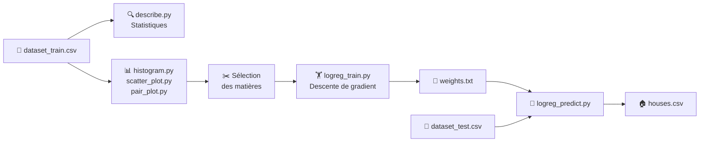
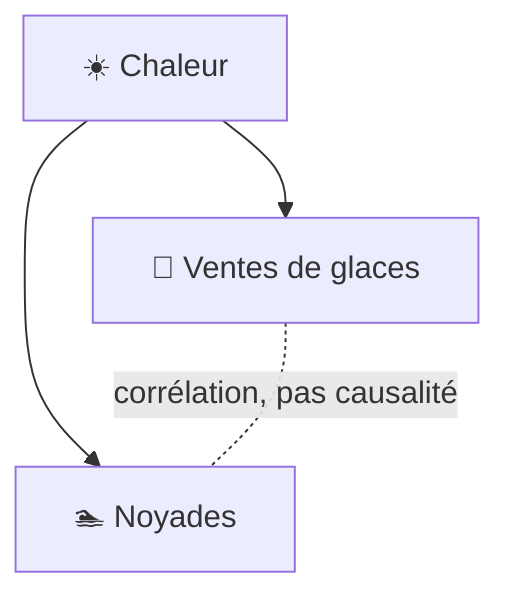
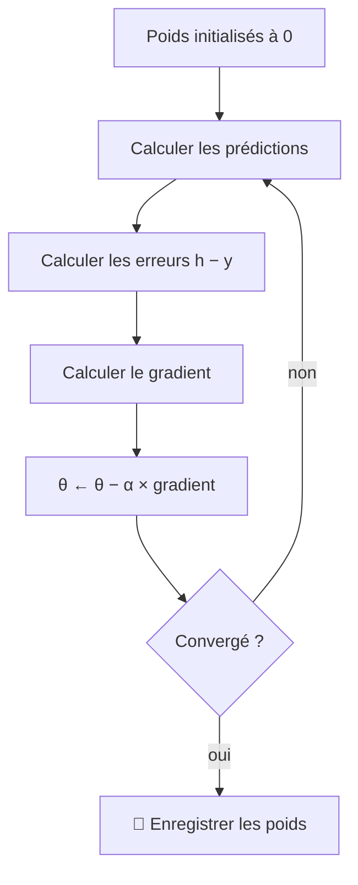

# 🎩 DSLR — Harry Potter and the Data Scientist

> *Le Choixpeau a été ensorcelé. Plus personne ne sait dans quelle maison envoyer les nouveaux élèves…*
> *Heureusement, un·e moldu·e armé·e de Python et d'une régression logistique est là pour le remplacer.* 🧙‍♂️🐍


-98.19%25-brightgreen)


---

## 📚 Sommaire

1. [Présentation du projet](#-présentation-du-projet)
2. [Installation et lancement](#-installation-et-lancement)
3. [Arborescence](#-arborescence)
4. [Compétences acquises](#-compétences-acquises)
5. [Les étapes du projet](#-les-étapes-du-projet)
   - [Exploration des données : `describe`](#41--exploration-des-données--describe)
   - [Feature selection](#42--feature-selection)
   - [Coefficient de corrélation de Pearson](#43--coefficient-de-corrélation-de-pearson)
6. [Corrélation vs causalité](#-corrélation-vs-causalité)
7. [Apprentissage supervisé vs non supervisé](#-apprentissage-supervisé-vs-non-supervisé)
8. [Surapprentissage et sous-apprentissage](#-surapprentissage-et-sous-apprentissage)
9. [Algorithmes de descente de gradient](#-algorithmes-de-descente-de-gradient)
10. [Résultats](#-résultats)
11. [Conclusion et pistes d'amélioration](#-conclusion-et-pistes-damélioration)

---

## 🏰 Présentation du projet

### Le problème

Le Choixpeau ne répond plus. Il faut pourtant répartir les élèves dans les quatre maisons de Poudlard : **Gryffindor**, **Slytherin**, **Ravenclaw** et **Hufflepuff**.

On dispose d'un grimoire numérisé : les notes des élèves dans treize matières, et, pour les élèves déjà répartis, leur maison.

### Le dataset

| Fichier | Contenu | Rôle |
|---|---|---|
| `datasets/dataset_train.csv` | ~1 600 élèves **avec** leur maison | Entraîner le modèle |
| `datasets/dataset_test.csv` | Élèves **sans** maison | Prédire leur maison |

Chaque ligne contient l'identité de l'élève (`Index`, `First Name`, `Birthday`…), sa maison (`Hogwarts House`) et ses notes : Arithmancy, Astronomy, Herbology, Defense Against the Dark Arts, Divination, Muggle Studies, Ancient Runes, History of Magic, Transfiguration, Potions, Care of Magical Creatures, Charms et Flying.

Certaines cases sont **vides** : il faudra les gérer.

### L'objectif

Construire un **classifieur multi-classes** par **régression logistique one-vs-all**, codé entièrement à la main, qui atteint au moins **98 % de bonnes réponses** sur le jeu de test.



---

## ⚙️ Installation et lancement

### Installation

Depuis la racine du dépôt :

```bash
source venv.sh
```

Le script installe les paquets système nécessaires, crée l'environnement virtuel `venv`, l'active et installe les dépendances listées dans `requirement.txt`.

> ⚠️ Utilisez bien `source` (et non `bash venv.sh`) : sinon l'environnement est activé dans un sous-shell, puis aussitôt perdu.

> 💡 Sous Ubuntu / WSL, l'affichage des fenêtres matplotlib nécessite Tkinter : `sudo apt install python3-tk`.

### Lancement

Les scripts se lancent depuis le dossier `srcs/` :

```bash
cd srcs

# 1. Statistiques descriptives
python3 describe.py ../datasets/dataset_train.csv

# 2. Visualisations
python3 histogram.py ../datasets/dataset_train.csv
python3 scatter_plot.py ../datasets/dataset_train.csv
python3 pair_plot.py ../datasets/dataset_train.csv

# 3. Entraînement → écrit ../ressources/weights.txt
python3 logreg_train.py ../datasets/dataset_train.csv

# 4. Prédiction → écrit ../ressources/houses.csv
python3 logreg_predict.py ../datasets/dataset_test.csv ../ressources/weights.txt
```

---

## 🗂️ Arborescence

```
DSLR/
├── venv.sh                 ← création et activation de l'environnement
├── requirement.txt         ← dépendances Python
├── datasets/
│   ├── dataset_train.csv
│   └── dataset_test.csv
├── ressources/
│   ├── weights.txt         ← poids, biais et statistiques de standardisation
│   └── houses.csv          ← prédictions finales
└── srcs/
    ├── describe.py         ← parser du CSV + statistiques descriptives
    ├── histogram.py        ← histogrammes par maison + score de Fisher
    ├── scatter_plot.py     ← corrélation de Pearson + nuage de points
    ├── pair_plot.py        ← matrice de nuages de points
    ├── logreg_train.py     ← sélection des matières + entraînement
    └── logreg_predict.py   ← prédiction + mesure de la précision
```

---

## 🎓 Compétences acquises

| Domaine | Compétence | Où dans le projet |
|---|---|---|
| 🐍 Python | Parsing de CSV sans bibliothèque, gestion des valeurs manquantes (`None`) | `parser`, `convert` |
| 📐 Statistiques | Moyenne, écart-type, quartiles codés à la main | `describe.py` |
| 📊 Visualisation | Histogrammes, nuages de points, matrice de nuages avec matplotlib | `histogram.py`, `scatter_plot.py`, `pair_plot.py` |
| 🔗 Analyse | Corrélation de Pearson, score de Fisher | `coefPearson`, `fisherScore` |
| ✂️ Préparation | Sélection de variables, standardisation | `paser_to_unuseful_stuff`, `standardization` |
| 🧠 Machine Learning | Régression logistique, sigmoïde, one-vs-all | `prediction`, `sigma` |
| ⛰️ Optimisation | Descente de gradient batch et stochastique, log loss | `GradientDescent`, `GradientDescentStochastique` |
| ✅ Évaluation | Précision sur un jeu étiqueté | `test` |
| 🧮 Maths | Dérivées, gradient, minimisation d'une fonction | Annexe du sujet |

---

## 🧭 Les étapes du projet

### 4.1 🔍 Exploration des données : `describe`

#### Principe

Avant d'entraîner quoi que ce soit, on regarde ses données. `describe.py` affiche, pour chaque matière numérique :

| Statistique | Signification |
|---|---|
| **Count** | Nombre de notes présentes (sans les cases vides) |
| **Mean** | Moyenne des notes |
| **Std** | Écart-type : à quel point les notes sont étalées autour de la moyenne |
| **Min** | Plus petite note |
| **25 %** | 1ᵉʳ quartile : un quart des élèves a une note inférieure |
| **50 %** | Médiane : la moitié des élèves est en dessous |
| **75 %** | 3ᵉ quartile : trois quarts des élèves sont en dessous |
| **Max** | Plus grande note |

> ⚠️ Le sujet interdit les fonctions toutes faites (`mean`, `std`, `percentile`, `describe` de pandas…). Tout est codé à la main.

#### À quoi ça sert

- **Valeurs manquantes** : un `Count` plus petit que le nombre d'élèves révèle des cases vides.
- **Échelles différentes** : Arithmancy monte jusqu'à des dizaines de milliers, Potions reste autour de quelques points. Il faudra les remettre à la même échelle.
- **Valeurs aberrantes** : un `Min` ou un `Max` très loin des quartiles signale des notes suspectes.

#### Utilisation dans un vrai modèle

C'est le premier réflexe de tout data scientist. On ne lance jamais un modèle sur des données qu'on n'a pas regardées.

#### Dans ce projet

Le parser convertit chaque valeur une seule fois, à la lecture. Une case vide devient `None`, ce qui garde toutes les colonnes alignées : la ligne `i` correspond toujours au même élève.

```python
def convert(value):
    if value == '':
        return None            # case vide → None (on ne supprime rien)
    try:
        return float(value)    # une note → nombre
    except ValueError:
        return value           # du texte (nom, maison…) → gardé tel quel
```

---

### 4.2 ✂️ Feature selection

#### Principe

Toutes les matières ne se valent pas pour deviner une maison. La **sélection de variables** consiste à ne garder que celles qui apportent une information utile et non redondante.

Il existe trois grandes familles :

| Famille | Idée | Exemple |
|---|---|---|
| **Filtre** | On trie les variables avec des critères statistiques, **avant** d'entraîner | Corrélation, score de Fisher |
| **Wrapper** | On teste plusieurs combinaisons de variables en entraînant le modèle à chaque fois | Sélection pas à pas |
| **Embedded** | Le modèle choisit lui-même pendant l'entraînement | Régularisation Lasso |

Ce projet utilise une **méthode de filtre**.

#### À quoi ça sert

- 🔇 **Réduire le bruit** : une variable inutile ajoute des poids qui ne servent à rien.
- 🎯 **Éviter le surapprentissage** : moins de paramètres, moins de risque d'apprendre par cœur.
- ⚡ **Accélérer l'entraînement** : moins de calculs à chaque itération.
- 🧩 **Éviter la multicolinéarité** : deux variables identiques empêchent le modèle de répartir correctement les poids.

#### Utilisation dans un vrai modèle

Pour prédire le prix d'un appartement, la surface en m² et la surface en pieds carrés disent exactement la même chose : on n'en garde qu'une. Et la couleur de la porte d'entrée n'a probablement aucun effet : on la retire.

#### Dans ce projet

Deux filtres successifs, dans `paser_to_unuseful_stuff` :

**1. Retirer les matières homogènes entre maisons**, grâce au **score de Fisher** :

$$\text{Fisher}(x_j) = \frac{\sum_{c=1}^{C} n_c\left(\mu_j^{(c)} - \mu_j\right)^2}{\sum_{c=1}^{C} n_c\left(\sigma_j^{(c)}\right)^2}$$

- $C$ : le nombre de maisons (4).
- $n_c$ : le nombre d'élèves de la maison $c$.
- $\mu_j$ : la moyenne de la matière $j$ sur tous les élèves.
- $\mu_j^{(c)}$ : la moyenne de la matière $j$ dans la maison $c$.
- $\sigma_j^{(c)}$ : l'écart-type de la matière $j$ dans la maison $c$.

Le numérateur mesure **à quel point les maisons sont éloignées les unes des autres**. Le dénominateur mesure **à quel point les élèves d'une même maison sont dispersés**. Un score proche de 0 signifie que les quatre maisons ont les mêmes notes : la matière est inutile.

> 🧠 Pourquoi pas simplement l'écart-type ? Parce qu'il dépend de l'échelle. Une matière notée sur 100 000 aurait toujours un grand écart-type, même si toutes les maisons se ressemblent.

**2. Retirer les matières redondantes**, grâce au coefficient de Pearson (section suivante).

```python
THRESHOLD_FISHER = 0.1
THRESHOLD_COEF_PEARSON = 0.95

def paser_to_unuseful_stuff(d):
    coursesUse = list(COURSES)                 # vraie copie de la liste
    for course in COURSES:                     # 1. matières qui ne séparent pas les maisons
        if fisherScore(d, course) < THRESHOLD_FISHER:
            coursesUse.remove(course)
    for a, b in combinations(COURSES, 2):      # 2. matières redondantes
        if not (a in coursesUse and b in coursesUse):
            continue
        xs, ys = paired(d[a], d[b])
        if abs(coefPearson(xs, ys)) > THRESHOLD_COEF_PEARSON:
            coursesUse.remove(a)
    return coursesUse
```

Les matières retenues sont calculées à l'exécution, puis enregistrées implicitement dans `weights.txt` (une ligne de poids par matière).

---

### 4.3 🔗 Coefficient de corrélation de Pearson

#### Principe

$$r = \frac{\sum (x_i - \bar{x})(y_i - \bar{y})}{\sqrt{\sum (x_i - \bar{x})^2}\sqrt{\sum (y_i - \bar{y})^2}}$$

- $x_i$, $y_i$ : les notes d'un **même élève** $i$ dans les deux matières comparées.
- $\bar{x}$, $\bar{y}$ : la moyenne de chaque matière (« x barre », « y barre »).
- Le numérateur (la covariance) est positif quand les deux notes s'écartent de la moyenne **dans le même sens**.
- Le dénominateur ramène le résultat entre −1 et 1, quelle que soit l'échelle des notes.

#### Interprétation

| Valeur de $r$ | Signification | Nuage de points |
|---|---|---|
| proche de **+1** | Quand l'une monte, l'autre monte | Ligne montante |
| proche de **0** | Aucun lien linéaire | Tache informe |
| proche de **−1** | Quand l'une monte, l'autre descend | Ligne descendante |

C'est la **valeur absolue** qui mesure la force du lien : −0,99 est aussi fort que +0,99.

> ⚠️ **Limite** : Pearson ne détecte que les relations **linéaires**. Deux variables liées par une courbe en U peuvent avoir $r \approx 0$ alors qu'elles sont fortement dépendantes.

#### Utilisation dans un vrai modèle

On calcule souvent la matrice de toutes les corrélations, affichée sous forme de **heatmap**, pour repérer d'un coup d'œil les variables redondantes.

#### Dans ce projet

`scatter_plot.py` teste les 78 paires de matières et trace la plus corrélée. Résultat :

> 🎯 **Astronomy** et **Defense Against the Dark Arts** : $r = -1{,}000$
> Les points forment une droite parfaite : $\text{Defense} = -\dfrac{\text{Astronomy}}{100}$.
> Les deux matières contiennent **exactement** la même information : on n'en garde qu'une.

Un piège évité : les notes doivent être **appariées** élève par élève. Supprimer les cases vides colonne par colonne décalerait les élèves. `paired` retire donc l'élève entier dès qu'une des deux notes manque :

```python
def paired(col_a, col_b):
    xs, ys = [], []
    for va, vb in zip(col_a, col_b):
        if va is not None and vb is not None:   # l'élève a ses deux notes
            xs.append(va)
            ys.append(vb)
    return xs, ys
```

---

## 🍦 Corrélation vs causalité

### Définitions

- **Corrélation** : deux variables varient ensemble.
- **Causalité** : l'une **provoque** l'autre.

Une corrélation ne prouve **jamais** une causalité à elle seule.

### L'exemple classique

📈 Les ventes de glaces et le nombre de noyades augmentent en même temps.
Est-ce que manger une glace fait couler ? Non : une **variable cachée**, la chaleur, pousse à la fois à acheter des glaces et à se baigner.



### Pourquoi c'est important en ML

- 🔮 **Pour prédire**, une corrélation stable suffit. Le Choixpeau numérique n'a pas besoin de savoir **pourquoi** les Ravenclaw réussissent en Astronomy, seulement que c'est le cas.
- 🧪 **Pour expliquer ou agir**, il faut la causalité. Forcer un élève à travailler l'Astronomy ne l'enverra pas à Ravenclaw.
- ⚠️ **Risque** : une corrélation due au hasard dans les données d'entraînement disparaît sur de nouvelles données. C'est pour ça qu'on évalue toujours le modèle sur des exemples qu'il n'a jamais vus (`dataset_test.csv`).

---

## 🏷️ Apprentissage supervisé vs non supervisé

### Définitions

- **Supervisé** : chaque exemple d'entraînement est accompagné de la **bonne réponse** (l'étiquette). Le modèle apprend à la reproduire.
- **Non supervisé** : pas de réponse. Le modèle cherche lui-même des structures dans les données.
- *(Bonus)* **Par renforcement** : le modèle apprend par essais et erreurs grâce à des récompenses, comme une IA qui joue au go.

### Tableau comparatif

| | Supervisé | Non supervisé |
|---|---|---|
| Données | Exemples **+ étiquettes** | Exemples seuls |
| Question | « Quelle est la réponse ? » | « Quels groupes existent ? » |
| Algorithmes | Régression linéaire, régression logistique, arbres de décision | k-means, ACP, clustering hiérarchique |
| Cas d'usage | Détection de spam, diagnostic, prix d'un bien | Segmentation de clients, compression, détection d'anomalies |
| Évaluation | Comparaison avec les vraies réponses | Plus subjective |

### 📍 Ce projet

C'est de l'**apprentissage supervisé**, et plus précisément de la **classification** : chaque élève de `dataset_train.csv` est fourni avec sa maison (la colonne `Hogwarts House`), et le modèle apprend à la prédire à partir des notes.

Si on avait seulement demandé de « regrouper les élèves en quatre groupes » sans connaître les maisons, ç'aurait été du non supervisé.

---

## 🎯 Surapprentissage et sous-apprentissage

### L'analogie de l'examen 📝

| Élève | Comportement | Résultat |
|---|---|---|
| 😴 **Sous-apprentissage** | N'a pas révisé | Mauvais aux exercices **et** à l'examen |
| 🦜 **Surapprentissage** | A appris les corrigés par cœur | Parfait sur les exercices connus, perdu à l'examen |
| 🧠 **Bon apprentissage** | A compris la méthode | Bon partout |

### Symptômes

| | Erreur sur l'entraînement | Erreur sur le test |
|---|---|---|
| Sous-apprentissage | Élevée | Élevée |
| Surapprentissage | Très faible | Élevée |
| Bon modèle | Faible | Faible |

### Causes et solutions

| Problème | Causes | Solutions |
|---|---|---|
| Sous-apprentissage | Modèle trop simple, pas assez d'entraînement, variables utiles retirées | Ajouter des variables, entraîner plus longtemps, modèle plus riche |
| Surapprentissage | Modèle trop complexe, trop peu de données, variables bruitées | Plus de données, **sélection de variables**, régularisation, arrêt anticipé |

### 📍 Ce projet

Le risque de surapprentissage est faible : la régression logistique est un modèle simple (un poids par matière + un biais) face à environ 1 600 élèves. La courbe du coût le confirme : elle se stabilise sur un plateau, et continuer l'entraînement n'apporte plus rien.

---

## ⛰️ Algorithmes de descente de gradient

### 8.1 Fondements communs

#### Le modèle : la régression logistique

Pour un élève, on calcule un **score** puis une **probabilité** :

$$z = \theta_0 + \theta_1 x_1 + \dots + \theta_n x_n \qquad h_\theta(x) = g(z) = \frac{1}{1 + e^{-z}}$$

- $x_1 \dots x_n$ : les notes standardisées de l'élève dans les matières retenues.
- $\theta_1 \dots \theta_n$ : les **poids**, un par matière. Positif : une bonne note rapproche de la maison. Négatif : elle en éloigne.
- $\theta_0$ : le **biais**, qui décale le seuil de décision.
- $g$ : la **sigmoïde**, qui écrase n'importe quel score en une probabilité entre 0 et 1.

#### One-vs-all

On entraîne **quatre** modèles indépendants, chacun avec ses propres poids : « Gryffindor ou pas ? », « Slytherin ou pas ? », etc. Pour un nouvel élève, on choisit la maison dont la probabilité est la plus forte.

| Modèle | Probabilité (exemple réel) |
|---|---|
| Gryffindor ou pas ? | 0,012 |
| Slytherin ou pas ? | 0,00006 |
| Ravenclaw ou pas ? | 0,00002 |
| **Hufflepuff ou pas ?** | **0,99996** → 🦡 Hufflepuff |

#### La fonction de coût

Le cas général souvent présenté est l'erreur quadratique moyenne (**MSE**), utilisée en régression linéaire :

$$J(\theta) = \frac{1}{2m}\sum_{i=1}^{m}\left(h_\theta(x^{(i)}) - y^{(i)}\right)^2$$

- $m$ : le nombre d'exemples.
- $h_\theta(x^{(i)})$ : la prédiction pour l'exemple $i$.
- $y^{(i)}$ : la vraie valeur.

Pour la régression logistique, le sujet impose la **log loss**, qui est celle utilisée dans ce projet :

$$J(\theta) = -\frac{1}{m}\sum_{i=1}^{m}\Big[y^{(i)}\log\big(h_\theta(x^{(i)})\big) + \big(1 - y^{(i)}\big)\log\big(1 - h_\theta(x^{(i)})\big)\Big]$$

- $y^{(i)}$ vaut 1 si l'élève est dans la maison étudiée, 0 sinon.
- Si $y = 1$, seul $\log(h)$ compte : il est proche de 0 quand le modèle prédit presque 1.
- Si $y = 0$, seul $\log(1 - h)$ compte.
- Le signe moins rend le coût positif. **Plus il est bas, meilleur est le modèle.**

> 🤔 Pourquoi pas la MSE ? Avec une sigmoïde, la MSE forme un paysage plein de plateaux où la descente avance mal. La log loss forme une **cuvette lisse** avec un seul minimum.

> 📏 Repère : avec tous les poids à 0, le modèle prédit 0,5 partout et le coût vaut $-\log(0{,}5) \approx 0{,}693$. C'est le niveau « je réponds au hasard ».

#### La règle de mise à jour

$$\theta := \theta - \alpha \nabla_\theta J(\theta)$$

Pour la log loss, chaque composante du gradient vaut :

$$\frac{\partial J}{\partial \theta_j} = \frac{1}{m}\sum_{i=1}^{m}\left(h_\theta(x^{(i)}) - y^{(i)}\right)x_j^{(i)}$$

- $\alpha$ : le **pas** (*learning rate*), `pas = 0.1` dans le code.
- $\nabla_\theta J$ : le **gradient**, la liste des dérivées du coût par rapport à chaque poids.
- $h - y$ : l'**erreur** de l'élève (positive si le modèle a prédit trop haut).
- $x_j$ : sa note dans la matière $j$. Plus elle est grande, plus le poids $\theta_j$ est responsable de l'erreur.

#### 🧮 Exemple pas à pas : une itération à la main

Modèle « **Ravenclaw ou pas ?** », avec une seule matière (Astronomy, déjà standardisée) et trois élèves.
On part de $\theta_0 = 0$ (biais) et $\theta_1 = 0$ (poids d'Astronomy), avec $\alpha = 0{,}1$.

**Étape 1 — Prédire.** Avec des poids nuls, le score vaut $z = 0$ pour tout le monde, donc $h = g(0) = 0{,}5$ : le modèle hésite complètement.

**Étape 2 — Mesurer l'erreur de chaque élève.**

| Élève | Note $x_1$ | Vraie réponse $y$ | Prédiction $h$ | Erreur $h - y$ | Erreur × note |
|---|---|---|---|---|---|
| 🧑‍🎓 A | 2 | 1 (Ravenclaw) | 0,5 | −0,5 *(trop bas)* | −0,5 × 2 = **−1,0** |
| 🧑‍🎓 B | 1 | 1 (Ravenclaw) | 0,5 | −0,5 *(trop bas)* | −0,5 × 1 = **−0,5** |
| 🧑‍🎓 C | −1 | 0 (autre maison) | 0,5 | +0,5 *(trop haut)* | +0,5 × (−1) = **−0,5** |

**Étape 3 — Calculer le gradient** (la moyenne de chaque colonne utile) :

$$\frac{\partial J}{\partial \theta_1} = \frac{-1{,}0 - 0{,}5 - 0{,}5}{3} \approx -0{,}667 \qquad \frac{\partial J}{\partial \theta_0} = \frac{-0{,}5 - 0{,}5 + 0{,}5}{3} \approx -0{,}167$$

Pour le biais, la « note » vaut toujours 1 : on moyenne donc simplement les erreurs.

**Étape 4 — Mettre à jour.**

$$\theta_1 := 0 - 0{,}1 \times (-0{,}667) = \mathbf{0{,}067} \qquad \theta_0 := 0 - 0{,}1 \times (-0{,}167) = \mathbf{0{,}017}$$

Le gradient est négatif, donc on **soustrait un nombre négatif** : les deux paramètres **augmentent**.
C'est logique : les élèves de Ravenclaw ont de bonnes notes en Astronomy, donc une bonne note doit faire monter le score.

**Étape 5 — Vérifier que ça s'améliore.**

| Élève | Nouveau score $z = 0{,}017 + 0{,}067 \times x_1$ | Nouvelle prédiction $h$ | Bonne réponse | Tendance |
|---|---|---|---|---|
| A | 0,150 | 0,537 | 1 | ⬆️ se rapproche de 1 |
| B | 0,083 | 0,521 | 1 | ⬆️ se rapproche de 1 |
| C | −0,050 | 0,488 | 0 | ⬇️ se rapproche de 0 |

Le coût passe de **0,693** à **0,647** : un petit pas dans la bonne direction.
On répète ensuite ces cinq étapes des centaines de fois, et les prédictions se rapprochent peu à peu des bonnes réponses.

#### 🔍 Deux détails qui comptent

**Pourquoi multiplier par la note ?**
Un élève avec une note de **0** n'est pas du tout influencé par le poids, puisque $\theta_1 \times 0 = 0$. Son avis sur ce poids est nul : $\text{erreur} \times 0 = 0$.
Un élève avec une note de 2 a beaucoup pesé dans son score : son erreur compte double.

**Pourquoi l'élève C pousse aussi à augmenter le poids ?**
Le modèle a prédit trop haut pour lui (erreur positive). Mais sa note est **négative** : pour faire baisser son score, il faut que le poids **augmente**, afin que $\theta_1 \times (-1)$ devienne plus négatif.
Le produit $(+0{,}5) \times (-1) = -0{,}5$ donne bien le bon sens. Sans la multiplication par la note, on aurait corrigé dans la mauvaise direction.

#### L'intuition : la randonnée dans le brouillard 🥾

La dérivée, c'est un appareil qui indique **la pente sous vos pieds** :
négative quand ça descend, positive quand ça monte, nulle au fond de la vallée.
À chaque pas, on avance dans le sens de la descente.



#### Le rôle du pas $\alpha$

| Pas | Effet |
|---|---|
| 🐌 Trop petit | Convergence très lente |
| ✅ Bien choisi | Descente régulière vers le minimum |
| 💥 Trop grand | Le coût oscille ou explose |

---

### 8.2 Batch Gradient Descent

#### Formule

On utilise **tous** les élèves pour **une seule** correction :

$$\theta_j := \theta_j - \alpha \cdot \frac{1}{m}\sum_{i=1}^{m}\left(h_\theta(x^{(i)}) - y^{(i)}\right)x_j^{(i)}$$

#### Illustration

Le randonneur consulte la carte complète avant chaque pas : chaque pas est précis, mais lent à décider.

```python
def GradientDescent(d, bias, weights, pas, courseUse, house):
    errors = []
    errorsNotes = {course: 0 for course in courseUse}
    for ligne in range(len(d["First Name"])):             # 1. on parcourt TOUS les élèves
        data = [d[course][ligne] for course in courseUse]
        prediction_value = prediction(data, bias, weights, courseUse)
        correct = (d["Hogwarts House"][ligne] == house)   # 1 si bonne maison, 0 sinon
        error = prediction_value - correct
        for i, course in enumerate(courseUse):
            errorsNotes[course] += error * data[i]        # on accumule sans rien modifier
        errors.append(error)
    for course in courseUse:                              # 2. UNE correction par passage
        weights[course] -= pas * errorsNotes[course] / len(errors)
    return bias - pas * sum(errors) / len(errors)
```

| ✅ Avantages | ❌ Inconvénients |
|---|---|
| Descente stable et régulière | Une seule correction par passage complet |
| Le coût baisse à chaque itération | Toute la base doit tenir en mémoire |

---

### 8.3 Stochastic Gradient Descent (SGD)

#### Formule

On corrige après **chaque** élève $i$, sans moyenne :

$$\theta_j := \theta_j - \alpha\left(h_\theta(x^{(i)}) - y^{(i)}\right)x_j^{(i)}$$

#### Illustration

Le randonneur regarde seulement le sol sous ses pieds et avance tout de suite : il zigzague, mais fait beaucoup plus de pas.

```
Batch :  ●────────────────────────────────►  (ligne droite, lente)
SGD   :  ●╱╲╱╲╱╲╱╲──╱╲─╱╲──────────────────►  (zigzags, rapide)
```

```python
def GradientDescentStochastique(d, bias, weights, pas, courseUse, house):
    lignes = list(range(len(d["First Name"])))
    random.shuffle(lignes)                                # ordre différent à chaque passage
    for ligne in lignes:
        data = [d[course][ligne] for course in courseUse]
        error = prediction(data, bias, weights, courseUse) - (d["Hogwarts House"][ligne] == house)
        for i, course in enumerate(courseUse):
            weights[course] -= pas * error * data[i]      # correction immédiate
        bias -= pas * error
    return bias
```

| ✅ Avantages | ❌ Inconvénients |
|---|---|
| Progresse très vite au début | Trajectoire bruitée |
| Un seul exemple en mémoire | Tourne autour du minimum sans s'y poser |
| Fonctionne avec des données qui arrivent en continu | Sensible à l'ordre des exemples (d'où le mélange) |

---

### 8.4 Mini-batch Gradient Descent

#### Formule

On corrige après chaque **lot** $B$ de $b$ élèves :

$$\theta_j := \theta_j - \alpha \cdot \frac{1}{b}\sum_{i \in B}\left(h_\theta(x^{(i)}) - y^{(i)}\right)x_j^{(i)}$$

- $b$ : la **taille de batch** (*batch size*), par exemple 32.
- Avec $b = m$, on retrouve le **batch**. Avec $b = 1$, on retrouve le **SGD**.

#### Illustration

Le randonneur regarde les quelques mètres autour de lui : un bon compromis entre précision et rapidité.

```
Batch      : |████████████████ 1 600 élèves ████████████████| → 1 correction
Mini-batch : |██ 32 ██|██ 32 ██|██ 32 ██| … |██ 32 ██|        → 50 corrections
SGD        : |█|█|█|█|█|█|█|█|█|█|█|█|█| … |█|               → 1 600 corrections
```

> 📝 Cette variante n'est pas encore présente dans le code : elle fait partie des pistes d'amélioration (bonus du sujet).

| ✅ Avantages | ❌ Inconvénients |
|---|---|
| Moins bruité que le SGD | Un paramètre de plus à régler ($b$) |
| Plus rapide que le batch | |
| Charge les données par morceaux | |

---

### 8.5 Prétraitement avant la descente : la standardisation

#### Formule

$$x' = \frac{x - \mu}{\sigma}$$

- $\mu$ : la moyenne de la matière, calculée sur l'entraînement.
- $\sigma$ : son écart-type.
- $x'$ : la note exprimée en « nombre d'écarts-types au-dessus ou en dessous de la moyenne ».

#### Pourquoi c'est indispensable

Sans standardisation, Arithmancy (jusqu'à ~100 000) écrase tout :

| Sans standardisation 💥 | Avec standardisation ✅ |
|---|---|
| Corrections gigantesques pour Arithmancy | Toutes les notes entre ~−3 et 3 |
| Poids de plusieurs milliers | Poids de l'ordre de quelques unités |
| `OverflowError` dans `math.exp` | Convergence stable |

```python
def standardization(arr, mean_init=None, std_value_init=None):
    mean = mean_init or sum(arr) / len(arr)       # moyenne fournie, ou calculée
    std_value = std_value_init or std(arr)
    for i in range(len(arr)):
        arr[i] = (arr[i] - mean) / std_value
    return arr, mean, std_value                   # on renvoie aussi les stats
```

> 🔑 La moyenne et l'écart-type de l'entraînement sont **écrits dans `weights.txt`**. `logreg_predict.py` les relit pour transformer les élèves de test **exactement de la même façon**. Une note manquante devient 0, c'est-à-dire la moyenne.

Une autre option existe, la **normalisation min-max** :

$$x' = \frac{x - \min}{\max - \min}$$

Elle ramène tout entre 0 et 1, mais elle est plus sensible aux valeurs extrêmes.

#### Autres garde-fous du code

- La sigmoïde borne le score à ±500 pour éviter le débordement de `math.exp`.
- La prédiction est bornée entre $10^{-15}$ et $1 - 10^{-15}$ avant les logarithmes du coût, pour éviter $\log(0)$.

```python
def sigma(z):
    z = max(-500, min(500, z))
    return 1 / (1 + math.exp(-z))
```

---

### 8.6 Tableau comparatif final

| | 🐢 Batch | 🐇 SGD | ⚖️ Mini-batch |
|---|---|---|---|
| Exemples par correction | Tous ($m$) | 1 | $b$ (ex. 32) |
| Vitesse par passage | Lente | Rapide | Rapide |
| Stabilité | ⭐⭐⭐ | ⭐ | ⭐⭐ |
| Mémoire | Toute la base | 1 exemple | 1 lot |
| Cas d'usage | Petits jeux de données | Flux continu, très gros volumes | Standard en deep learning |
| Dans ce projet | ✅ `GradientDescent` | ✅ `GradientDescentStochastique` | 🔜 piste d'amélioration |

---

## 📈 Résultats

### Visualisations

| Question du sujet | Méthode | Réponse |
|---|---|---|
| Quelle matière a une distribution homogène entre les maisons ? | Histogrammes par maison + score de Fisher | Les matières au score de Fisher le plus faible |
| Quelles sont les deux matières qui se ressemblent ? | Pearson sur toutes les paires | **Astronomy** et **Defense Against the Dark Arts** ($r = -1{,}000$) |
| Quelles matières garder pour la régression ? | Pair plot coloré par maison | Celles où les maisons forment des groupes séparés, sans doublon |

### Évolution du coût

Le coût de chaque maison part de ~0,693 (hasard) et se stabilise sur un plateau. Valeurs observées en fin d'entraînement :

| Maison | Coût final |
|---|---|
| 🦁 Gryffindor | ≈ 0,069 |
| 🐍 Slytherin | ≈ 0,059 |
| 🦅 Ravenclaw | ≈ 0,044 |
| 🦡 Hufflepuff | ≈ 0,040 |

Les baisses entre deux itérations ne sont plus que de quelques millionièmes : le modèle a **convergé**.

### Précision

Mesurée en relançant la prédiction sur `dataset_train.csv`, dont on connaît les vraies maisons :

> 🎉 **29 erreurs sur 1 600 élèves → 98,19 % de réussite**
> Objectif du sujet : 98 % ✅

Les erreurs sont réparties entre toutes les maisons : ce sont des élèves « à la frontière », aux notes atypiques pour leur maison, et non un défaut systématique du modèle.

---

## 🏁 Conclusion et pistes d'amélioration

### Ce qu'on retient

1. 🔍 **Regarder ses données d'abord** : échelles, valeurs manquantes, redondances.
2. ✂️ **Moins de variables, mais les bonnes** : Fisher pour l'utilité, Pearson pour la redondance.
3. 📏 **Standardiser** : sans ça, la descente de gradient explose.
4. ⛰️ **La descente de gradient, c'est descendre une vallée à l'aveugle** en suivant la pente.
5. ✅ **Évaluer** sur des données étiquetées, et jamais se fier à un seul exemple.

### Pistes d'amélioration

- ⚖️ **Mini-batch gradient descent**, avec la taille de lot en paramètre (bonus du sujet).
- 🚀 **Optimiseurs avancés** : Momentum, Adam.
- 🛑 **Arrêt anticipé** : stopper quand le coût ne baisse plus, au lieu d'un nombre fixe d'itérations.
- 🧪 **Jeu de validation** : garder 20 % de l'entraînement de côté pour mesurer la généralisation.
- 🩹 **Valeurs manquantes** : reconstituer une note manquante d'Astronomy à partir de Defense (et inversement), puisqu'elles sont parfaitement liées.
- 📊 **Courbe du coût** tracée avec matplotlib.
- ➕ **Plus de champs dans `describe`** (bonus du sujet).

---

<p align="center">
  <i>Le Choixpeau est réparé : il ne lit plus dans les pensées, il lit dans les <b>features</b>.</i> 🎩✨
</p>
